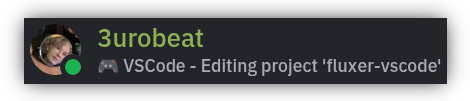

    <h1>fluxer-vscode</h1>
    

    <h4>💻 Update your Fluxer status with your VSCode/ium activity!</h4>
    

        <a href="#features">Features</a> •
        <a href="#installing">Installing</a> •
        <a href="#settings">Extension Settings</a>
    

 

&nbsp;

&nbsp;

## Features
- Automatically syncs your current VSCode activity to your Fluxer status
- Displays the file or workspace you are currently working on
- Customizable status format with configurable app name, activity text and behavior, see [Extension Settings](#settings)

> [!NOTE]
> Fluxer does not yet support Rich Presence (RPC), so this extension uses the Custom Status feature to show your activity.  
> This requires the extension to use your user token to authenticate the API requests.  
> As soon as Fluxer adds support for RPC, this extension will be updated to utilize it.

&nbsp;

## Installing
Open VSCode and install the extension from the [Visual Studio](https://marketplace.visualstudio.com/items?itemName=3urobeat.fluxer-vscode) or [OpenVSX](https://open-vsx.org/extension/3urobeat/fluxer-vscode) Marketplace or the [VSIX](https://github.com/3urobeat/fluxer-vscode/releases/latest) file.  
An error notification regarding a missing user token will appear. Click the notification's `Open Settings` button.

You need to provide your Fluxer user token so the extension can make the API requests to update your account's status.  

To retrieve your user token:
1. Log in to Fluxer at [https://web.fluxer.app](https://web.fluxer.app) or your desktop app
2. Open your Developer Tools by pressing <kbd>F12</kbd> (browser) or <kbd>Ctrl</kbd>+<kbd>Shift</kbd>+<kbd>I</kbd> (desktop app)
3. Go to the `Application` Tab at the top
4. Under `Storage` on the left, unfold `Local storage` and `https://web.fluxer.app`
5. Find the entry `token` in the table on the right and copy its value `flx_abcdefg...`
6. Back in VSCode, paste the token into the `Fluxer: Token` field.
7. The extension will automatically reload. Open a project and take a look at your Fluxer status!

&nbsp;

> [!WARNING]
> User tokens are sensitive information and provide access to your account. They must not be shared with anyone.  
> Your configured token is stored in your VSCode's `settings.json` file, located at `~/.config/VSCode/User/settings.json`.  
> Make sure you don't blindly share your VSCode configuration with someone else.  
> Should your token ever get leaked, update your Fluxer password to invalidate old tokens/sessions.

&nbsp;

## Extension Settings
The extension exposes the following settings:

| Setting | Default | Description |
|---------|---------|-------------|
| `fluxer.enable` | true | Controls whether extension is enabled |
| `fluxer.updateCheckInterval` | 5000 | Controls interval in ms to check for new activity and update Fluxer status. Set to 0 to disable periodic check |
| `fluxer.statusUntil` | 300000 | Controls how long your Fluxer status will remain if not updated. Recommended to be left at default |
| `fluxer.token` |  | User Token to authenticate with Fluxer. This is sensitive and should not be shared |
| `fluxer.status.format` | "🎮 {appName} {activityText}" | Controls formatting of status text. Variables: {appName}, {activityText} |
| `fluxer.status.activityText` | "- {activity}" | Controls formatting of activity text to show in status text. Variable {activity} will be replaced by your active workspace or file |
| `fluxer.status.appName` | "VSCode" | Application name to show in status text |
| `fluxer.status.showIdle` | true | If disabled, extension will clear {activityText} instead of showing 'Idling' when no text editor is active |
| `fluxer.status.clearIdleAfter` | 0 | Time in ms of being idle after which your status should be cleared. Set to 0 to never clear |
